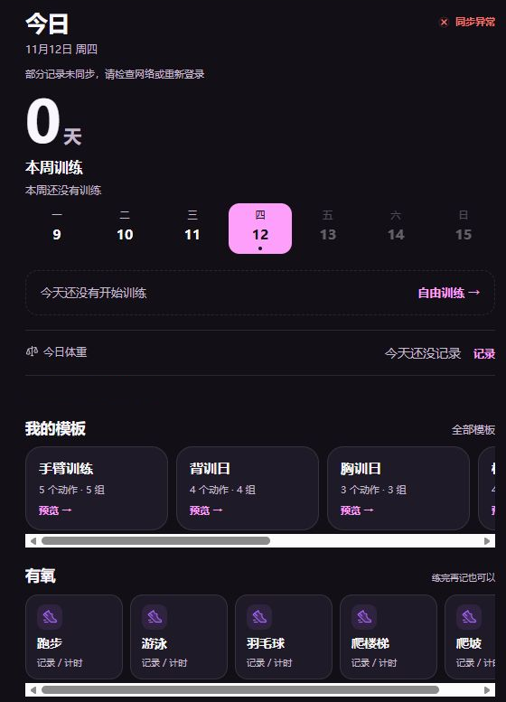
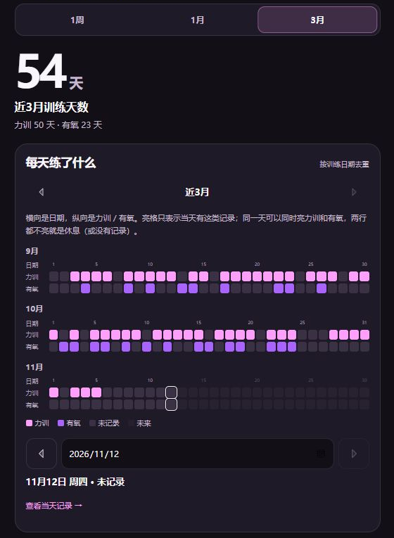
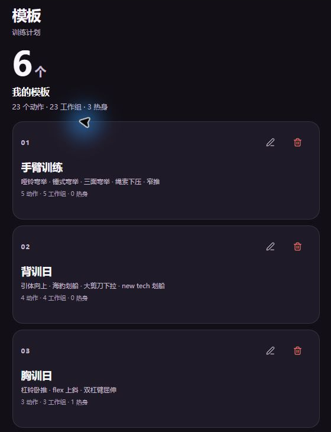
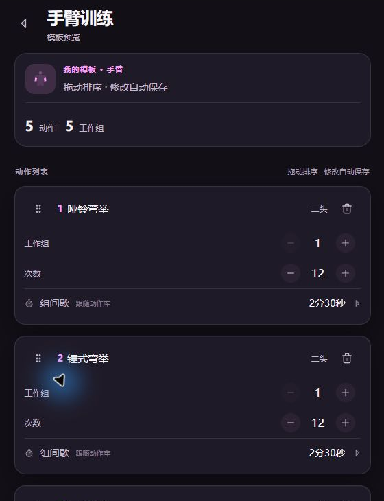

# GTworkout

**一款面向手机使用的个人训练日志。** 用模板安排力量训练，在组间记录重量和次数，把力量、有氧与体重放在同一个训练日历里复盘。

[打开线上应用](https://gtworkout.top/) · [核心功能](#核心功能) · [实际运行截图](#实际运行截图) · [本地运行](#本地运行)

## 核心功能

| 场景 | 可以做什么 |
| --- | --- |
| **训练前** | 从「今日」选择模板或开始自由训练。模板可以复用常练的动作，并预设顺序、热身组、工作组、次数和组间休息。动作库支持按部位筛选和搜索。 |
| **训练中** | 逐组录入重量、次数与 RPE（主观用力程度），勾选完成，按组间倒计时安排下一组。常练动作可以参考上一次的成绩。 |
| **记录有氧** | 为跑步、游泳、羽毛球等活动开始计时，也可以训练结束后补录。 |
| **训练后** | 从「历史」按日期查找力量或有氧记录，打开详情回看动作与组数。用「趋势」查看训练日历、近期频率和体重变化。 |
| **管理数据** | 在「我的」管理账号、动作和模板，导出 JSON 留存，或从已有备份导入。线上账号在有网时同步，页面会提示同步状态。 |

第一次使用时，可以从「今日」打开一套模板的预览，调整计划后开始训练。完成后去「历史」核对当次记录，再到「趋势」查看它所在的训练日。

## 实际运行截图

以下图片来自已登录的线上应用。截图裁掉了浏览器界面和体重数值，保留了模板配置和趋势汇总。

| 今日 | 训练趋势 |
| --- | --- |
|  |  |
| 查看本周安排，进入自由训练、模板预览或有氧计时。 | 切换统计区间，用不同颜色查看力量和有氧训练的分布。 |

| 我的模板 | 模板预览 |
| --- | --- |
|  |  |
| 用部位或训练日组织训练计划。 | 开练前核对动作顺序、组数、次数与休息时间。 |

## 代码与架构

线上站点与 GitHub 默认分支的版本节奏不同，上面的截图以线上界面为准。下面的命令和工程文档对应仓库源码。

- **前端**使用 React、TypeScript 和 Vite，支持安装为 PWA。训练数据通过 Dexie 保存在浏览器 IndexedDB 中，本地训练录入与计时可以独立于模型服务运行。
- **后端**使用 Java 17、Spring Boot、MyBatis 和 PostgreSQL。Spring Security 与 Spring Session 管理会话，Flyway 管理数据库版本。账号训练与版本化 JSON 备份各有独立入口。
- **备份与分析**保留上传的原始 JSON。后端通过持久任务将备份转成可查询的快照，按该版本统计训练次数、有效组、容量、体重和动作趋势。
- **教练 Agent**是仓库中需要单独配置模型的功能。用户选定已处理的快照、日期范围和允许使用的动作，DeepSeek 读取限定的统计与动作数据后生成训练草案。服务端校验草案，用户确认后可以应用为本地模板。流程和启用条件见 [Agent 接口与配置](docs/contracts/p3-assistant.md)。
- **部署**由 Nginx 提供前端并代理同源 API，Docker Compose 编排 Web、Java 和 PostgreSQL。

| 路径 | 内容 |
| --- | --- |
| [`src/`](src/) | 页面、训练录入、浏览器存储和 API 客户端 |
| [`server/`](server/) | 账号、训练、备份、统计投影、任务和教练 Agent |
| [`infra/`](infra/) | Docker Compose、Nginx 与运行脚本 |
| [`docs/`](docs/) | 架构、接口契约和验收记录 |

## 本地运行

### 启动完整应用

在 Windows 上启动 Docker Desktop 的 Linux 容器引擎，然后在仓库根目录的 PowerShell 中运行：

```powershell
.\infra\start-local.ps1 -EnableRegistration
```

打开 [http://localhost:8088](http://localhost:8088)。如果要体验云功能，在本地版的「数据备份 → 云服务与连接状态」注册并登录。`-EnableRegistration` 为本次本地启动开启注册，服务入口绑定回环地址。运行、停止及数据库凭据处理见 [本地运行手册](infra/README.md)。

### 开发前端与运行检查

使用仓库锁文件安装前端依赖，再启动 Vite。需要完整账号或云功能时，使用上面的同源 Docker 入口。

```powershell
npm ci
npm run dev
```

前端检查：

```powershell
npm run build
npm run lint
npm run test:contracts
```

后端检查需要 Java 17 和可用的 Docker 引擎。Maven Wrapper 的 `verify` 会通过 Testcontainers 运行独立 PostgreSQL 集成测试。

```powershell
cd server
.\mvnw.cmd verify
```

## 项目文档

- [架构说明](docs/architecture.md)
- [账号训练首版交接](docs/training-v1-handoff.md)
- [版本化备份与统计任务](docs/contracts/p2-processing.md)
- [教练 Agent 的任务与草案契约](docs/contracts/p3-assistant.md)
- [冷恢复、回退与负载验证](docs/verification/2026-10-16-p4.md)
- [服务器运维](docs/server-operations.md)
