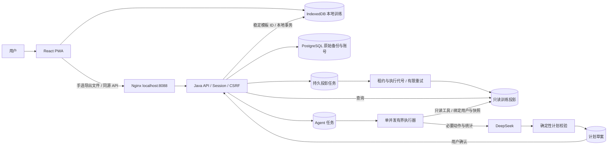

# Workout 当前架构

状态：2026-10-16，本机 P3 实现；P4 验证进展见 [进度](progress.md)。

训练计时、逐组记录和本地保存只依赖浏览器。本地库与云账号分离，登录不自动上传，云端不自动覆盖本地。备份是不可变历史版本，分析和 Agent 都绑定某一份快照。

## 三个关键事务

1. 上传：认证上下文决定用户，锁用户行检查配额；用户+幂等 key 唯一，比较请求指纹；原字节与投影任务同事务入库。下载返回原字节，不从投影重新拼文件。
2. 投影发布：短事务领取，解析在事务外；批量写入与任务代号条件提交同事务。失效执行不能发布半份结果；只有提交后 READY 才可查询。
3. Agent：独立任务和执行器，不复用单备份单投影唯一约束。模型只读工具，规则校验成功后草案与任务成功同事务保存。确认版本幂等，本地按稳定 ID 添加缺失模板，保留后续编辑。

## 数据和故障边界

- 完整动作库按需从已鉴权原文件提取，历史动作投影只代表练过的动作。
- 模型不接触密码、会话、照片、备注或完整备份。输出动作与数值由代码复核；复盘数字由服务端统计提供。
- 投影属于可确定重算的本地工作，可以有限重试。未知结果的付费模型请求不自动重放，逾期标记失败，由用户明确发起新任务。
- 同一库中的 JDBC 会话、备份、投影与草案可以逻辑归档恢复；恢复验证不等于异地灾备、生产 RPO/RTO 或任意版本兼容。
- 本机入口仅回环地址；模型未配置不影响训练、备份和统计。当前按单实例设计，尚无跨副本全局 Agent 并发控制。

具体约束见 [P2](contracts/p2-processing.md)、[P3](contracts/p3-assistant.md)；部署、故障排查和凭据处理见 [本机运行说明](../infra/README.md)。
