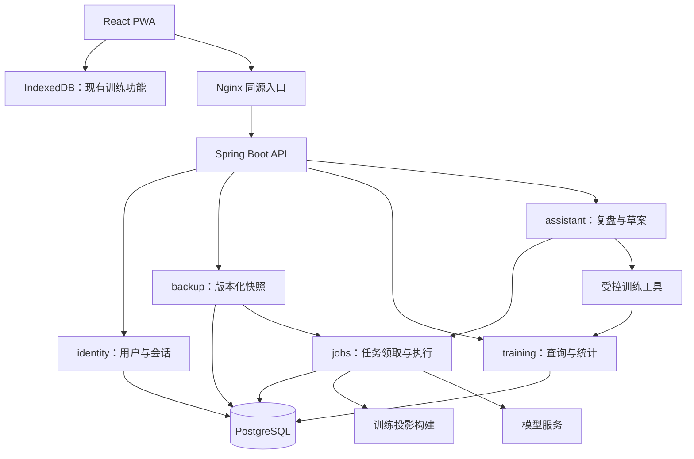

# Workout Java 后端项目实施方案

> 编写日期：2026-10-16。状态：待换机后分阶段实施。
>
> 本文是设计与验收基线，不代表后端已实现、数据库已创建或服务已部署。本次仅新增项目规范与本方案，不改业务代码，不执行建表、迁移、依赖安装或发布。

## 1. 目标与项目定位

### 1.1 首要目标

将已有个人健身 PWA 演进为可实际使用、可部署、可测试、能解释关键工程取舍的 Java 后端简历项目。

推荐项目名：**Workout：支持版本化云备份与智能训练复盘的个人训练管理平台**。

简历叙事主线：

> 从真实使用的训练记录工具出发，设计多用户云备份和训练快照分析服务，解决重复提交、异步处理失败恢复、数据隔离和统计一致性问题，在此基础上通过工具调用实现训练复盘与计划生成。

后端是主干，Agent 是扩展。完成账号、备份、异步处理和查询分析后，即应形成独立可交付的后端项目；模型接入不能成为后端交付的前置条件。

### 1.2 成功标准

1. 原有本地训练功能可在未登录、断网、后端不可用时继续使用。
2. 用户可登录并上传自己的备份，查看版本、处理状态，下载恢复文件。
3. 上传重试不生成重复版本；非法备份、越权请求和超限请求被明确拒绝。
4. 已上传数据可生成可查询的训练快照；处理中断后能够恢复，失败不影响原始备份下载。
5. 云端分析的日期、有效组、容量、体重等口径有明确契约和测试依据。
6. Agent 基于用户指定的快照调用查询工具，输出有记录依据的复盘和合法的计划草案。
7. Docker Compose 能启动交付版本，具有健康检查、持久化数据卷、运行说明和备份恢复演练。
8. 简历每个亮点都有对应代码、自动化测试、演示步骤或实测报告；不虚构用户数、QPS、可用性或性能提升。

### 1.3 明确不做

- 多设备实时同步、双向增量同步、离线编辑冲突自动合并、CRDT。
- 将训练计时、逐组保存和历史查看改成必须联网的操作。
- 微服务、注册中心、网关集群、Kubernetes、多地区容灾。
- 商城、支付、社交、预约等与训练数据闭环无关的业务。
- 第一版引入 Redis、消息队列、独立向量数据库、RAG 知识库或多 Agent 编排。
- Agent 自动修改训练历史、自动应用模板或自行执行数据库写操作。
- 声称多实例高可用、消息恰好一次或未经验证的高并发能力。

## 2. 现有项目边界与改造原则

### 2.1 已有资产

- React 19 + TypeScript + Vite 8 + Tailwind CSS 4。
- Dexie v4：`exercises`、`templates`、`sessions`、`weights` 四张表。
- 力量、有氧、休息日、训练模板、体重、历史、统计及 JSON 导入导出。
- 备份导出格式为 version 3；现有导入兼容缺少部分字段的旧备份。
- `src/lib/set.ts` 集中定义有效组和容量；`src/lib/date.ts` 定义本地日期语义。
- `ActiveWorkout.tsx` 耦合了训练初始化、计时、编辑与保存；第一版尽量不触及。

### 2.2 职责划分

| 数据/行为 | 权威来源 | 第一版处理方式 |
|---|---|---|
| 当前设备的训练和模板 | 本地 IndexedDB | 沿用现有读写 |
| 当前设备每日体重 | 本地 `weights` | 沿用现有读写 |
| 云备份 | 用户明确上传的不可变文件 | 云端版本化保存 |
| 云端训练分析 | 指定备份生成的只读投影 | 不回写本地历史 |
| 计划草案 | 后端保存的结构化建议 | 预览确认后新增本地模板 |
| 模型回答中的数值 | Java 统计工具结果 | 模型不得自行替代计算 |

“云备份”不等于“云同步”。UI 必须展示快照上传时间和分析数据截止时间，用户继续本地训练后，旧快照不会自动更新。

### 2.3 前端变更范围

- 新增 `src/api/`：请求、错误映射、会话与 CSRF 处理。
- 新增云服务页面：登录、备份列表、上传、任务状态、快照分析、Agent 与草案预览。
- 设置页增加独立入口，原导入导出保留。
- 第一轮上传使用文件选择器读取用户已导出的 JSON，不修改原 `buildBackup` 和导入事务。
- 一键上传当前数据在后续阶段单独接入：以只读事务获得一致快照，不复用或重写危险的恢复路径。
- 不为保存云端状态新增 Dexie 表。页面级状态与 API 状态分开，云端状态不能覆盖训练编辑状态。
- 共享浏览器中登录云端账号不自动认领、上传、清空或切换本地数据；上传前展示账号与内容数量，要求用户明确发起。

### 2.4 换机与域名迁移

IndexedDB 按浏览器 origin 隔离。切换电脑、浏览器或从 Cloudflare 域名切换到新域名后，原本地库不会自动出现。

迁移步骤：旧站点导出 JSON → 保留副本 → 新设备/新站点打开 → 使用现有导入功能恢复 → 验证训练、模板、体重数量与抽样记录。

不得把“新域名里没有记录”误判为库被删除。前端资源仍可独立部署；集成版优先同源托管，避免跨站 Cookie 成为第一版复杂度。

## 3. 技术选型与取舍

| 层次 | 选择 | 原因及边界 |
|---|---|---|
| Java | Java 21 LTS | 统一开发、构建和运行基线；使用受支持的语言特性，不依赖本机 JDK 24 特性 |
| Web | Spring Boot 3.5.x + Spring MVC | 与既定 Spring AI 1.1.x 配套，使用成熟 Servlet 模型；不混用 WebFlux |
| 构建 | Maven Wrapper 3.9.x | 固定项目工具链，不要求修改全局 Maven |
| 持久化 | PostgreSQL 17.x | 关系约束、JSONB、事务和任务领取使用同一数据库；固定受支持补丁版本 |
| SQL 访问 | MyBatis Spring Boot Starter 3.0.x | 显式 SQL 便于展示查询、索引、行锁与事务；不同时引入 JPA/MyBatis-Plus |
| 迁移 | Flyway | 可审阅的版本迁移；禁止自动建表和启动时随意修复结构，建表/迁移须先授权 |
| 身份认证 | Spring Security + Spring Session JDBC | 同源 Web 的服务端会话，支持退出与失效；不自建 JWT 刷新令牌体系 |
| 密码 | Spring Security 自适应密码编码器 | 首版 BCrypt，限制 UTF-8 字节长度避免静默截断，成本参数经目标机器测试确定 |
| Agent | Spring AI 1.1.x | 与 Java 业务服务共用鉴权、工具、校验与观测；具体模型由后续配置选择 |
| 任务 | PostgreSQL 持久任务表 + 有界执行器 | 支持领取、租约、重试和恢复；无跨服务消息需求时不引入 MQ |
| API | REST + OpenAPI，RFC 9457 Problem Details 错误 | 稳定错误码、字段错误与 traceId；不把异常堆栈返回浏览器 |
| 观测 | Actuator + Micrometer + 结构化日志 | 首版保留可导出指标，不强制部署完整监控套件 |
| 测试 | JUnit 5、Spring Boot Test、Testcontainers PostgreSQL | 对 SQL 约束和并发行为使用真实 PostgreSQL；不以 H2 替代 |
| 交付 | Docker 多阶段构建 + Docker Compose + Nginx | 同源入口、健康检查、数据卷；本地开发允许直接启动 Java |

版本策略：以上固定技术主线；P0 在目标机器锁定可获取的补丁版本及镜像摘要，记录到构建文件与版本清单，禁止 `latest`、SNAPSHOT 或动态版本。Boot 3.5 是兼容性选择，并非声称它是最新主版本；若目标实施时已不在所需维护窗口，则在写代码前重新评估整套 Boot/AI 组合。

官方依据：

- [Spring Boot 3.5 系统要求](https://docs.spring.io/spring-boot/3.5/system-requirements.html)：当前本机 Maven 3.6.1 低于其要求，使用项目 Wrapper 解决。
- [Spring AI 官方版本主线](https://github.com/spring-projects/spring-ai)：实施时再次检查 1.1.x 与 Boot 3.5.x 的兼容关系。
- [Spring Security CSRF](https://docs.spring.io/spring-security/reference/servlet/exploits/csrf.html)：Cookie 会话的写请求保留 CSRF 防护，不通过关闭防护简化接入。
- [PostgreSQL SELECT 行锁](https://www.postgresql.org/docs/17/sql-select.html)：`SKIP LOCKED` 仅用于队列领取，不作为普通业务查询的一致性方案。

## 4. 架构与模块边界



### 4.1 目录结构

```text
Workout/
├── AGENTS.md
├── src/                         # 现有前端
│   ├── api/                     # 后端请求和契约
│   └── pages/                   # 新页面按现有方式接入
├── server/
│   ├── pom.xml
│   ├── mvnw / mvnw.cmd
│   ├── .mvn/wrapper/
│   └── src/
│       ├── main/java/io/github/cgz4526/workout/
│       │   ├── WorkoutApplication.java
│       │   ├── identity/
│       │   ├── backup/
│       │   ├── training/
│       │   ├── jobs/
│       │   ├── assistant/
│       │   └── shared/
│       ├── main/resources/       # 无真实凭据的配置、Mapper、获批迁移
│       └── test/                # 单元与真实 PostgreSQL 集成测试
├── docs/
│   ├── backend-implementation-plan.md
│   ├── adr/                     # 重要决策，按需创建
│   ├── contracts/               # 备份/统计契约与合成夹具说明
│   └── verification/            # 验收与性能报告
├── tests/                       # 前后端契约与端到端验证
└── infra/
    ├── README.md
    ├── compose.yaml
    ├── nginx/
    └── docker/                  # Dockerfile 等
```

这是目标目录；按阶段创建，不先堆空文件。ADR 用 `NNNN-topic.md`，报告用 `YYYY-MM-DD-topic.md`。生成的 OpenAPI 与镜像不作为手工维护的源码。禁止真实用户数据进入夹具。

### 4.2 模块职责

| 模块 | 拥有的职责 | 对外边界 |
|---|---|---|
| `identity` | 用户、登录、会话、访问策略 | 当前用户上下文，不暴露密码模型 |
| `backup` | 文件校验、版本、原始内容、处理状态 | 提供当前用户快照及下载，不直接执行业务统计 |
| `training` | 从快照构建投影、日期和组级统计、查询 | 对 API 与 Agent 提供同一组查询服务 |
| `jobs` | 持久任务状态、领取、重试、恢复 | 按任务类型调用处理器，不包含训练语义 |
| `assistant` | Agent 执行、工具适配、计划草案、评测 | 调用 `training`，不能绕过服务直接访问其他模块 Mapper |
| `shared` | 错误协议、时间、少量基础配置 | 不演变成收纳所有业务逻辑的工具包 |

模块内部先用 controller/service/mapper/model 组织，复杂规则再提取专门类。不为简单 CRUD 机械创建四层接口与实现。用架构测试防止 controller 调 Mapper、assistant 绕过训练服务和循环依赖。

## 5. 核心业务设计与后端亮点

### 5.1 场景 A：网络超时后重复上传备份

**业务问题**：请求已经提交成功，浏览器没收到响应；用户重试会产生重复版本，甚至重复处理任务。

设计：

1. 客户端为一次上传意图生成 `Idempotency-Key`，失败重试复用同一 key 和相同文件字节。
2. 请求使用 multipart：原始 JSON 文件、用户选择的 IANA 时区；不使用 base64 再包一层 JSON。
3. Nginx 和服务端双重限制请求大小；解析前/过程中限制 JSON 深度、数组数量、单条字符串长度及总节点预算。
4. 初始上限按 20 MiB 文件设计，连同 multipart 额外开销设置入口限制；上线前用含照片的合成备份实测确认。超过限制明确拒绝，不静默丢弃照片。
5. 在读取字节时计算 SHA-256；幂等指纹包含文件摘要、时区、契约版本。摘要用于完整性与请求比对，不等同于内容去重。
6. 数据库唯一约束 `(user_id, idempotency_key)` 仲裁竞争；不能只使用“先查再插”。
7. 同一事务保存原始文件、备份元数据和待处理任务。提交成功后才返回 `202 Accepted` 与 `backupId/jobId`。
8. 同 key、同指纹返回已创建的资源；同 key、不同指纹返回 `409`。故障导致事务未提交时不留下空版本。

第一版不做跨用户内容去重，也不通过摘要推断其他用户是否上传过相同文件。列表不返回原始 JSON 和照片。

**验收证据**：同一用户同 key 并发上传只产生一个备份和一个任务；错误负载重用 key 被拒绝；在任务插入处注入失败，备份事务完整回滚。

**可写亮点**：数据库约束驱动的接口幂等、事务一致性、输入资源控制。不能写成“分布式锁保证高并发”或“消息恰好一次”。

### 5.2 场景 B：备份需要可恢复，分析需要可查询

**业务问题**：原始备份适合完整恢复，却不适合每次统计都整份解析；只保留结构化表又可能丢失旧版本字段。

设计为两份职责不同的数据：

- **恢复文件**：存原始 UTF-8 文件字节、摘要、格式版本和大小；下载可验证字节一致，未知但合法的附加字段不丢失。
- **查询投影**：对已验证的训练、动作和每日体重建立结构化记录，供统计和 Agent 使用；不复制照片到查询投影。

原始字节首版使用 PostgreSQL `BYTEA`，在体积限额下换取单库事务与简洁部署。不要把 JSONB 声称为原始文件字节的无损保存。结构化草案、校验摘要等可用 JSONB。对象存储在备份体积或保留量达到实测瓶颈后再引入。

处理状态：`PROCESSING → READY | FAILED`。原始上传校验通过即允许下载，即使投影失败也保留恢复能力；只有 `READY` 能提供分析。

投影构建在一次事务内完成。失败时整份投影回滚；成功后再将备份标记 `READY`。对业务键建唯一约束，避免重复执行留下重复组记录。第一版采用受限大小快照和单事务，不先实现分片索引和分阶段可见性。

**验收证据**：投影中途失败后不存在半份可查询数据；恢复执行后与首次成功结果一致；下载文件摘要与上传一致；不支持的版本在上传时拒绝，不能标记成功后返回空分析。

**可写亮点**：原始快照与查询投影分离、数据兼容契约、事务性投影构建。它是单体内的数据设计，不包装成事件溯源或复杂 CQRS 平台。

### 5.3 场景 C：进程重启后异步任务继续处理

**业务问题**：使用 `@Async` 后立即返回成功，如果进程在执行前退出，任务会丢失；外部模型响应慢也不能长期占用 HTTP 请求线程。

任务状态：

```text
PENDING → RUNNING → SUCCEEDED
             ├──→ RETRY_WAIT → RUNNING
             └──→ FAILED
```

设计：

- 待执行任务与业务记录同库持久化，提交后可被轮询领取；不称为 MQ，也不为此新增消息中间件。
- 领取时用短事务和 `FOR UPDATE SKIP LOCKED`，更新租约、执行次数、下次运行时间及执行代号；领取后释放锁。
- 执行期间不持有数据库事务等待模型或长计算，使用有界线程池与任务类型并发上限。
- 任务执行有期限；租约续期受最大执行时间约束，终止的进程无法续期，过期任务进入恢复流程。
- 完成/失败提交时带执行代号做条件更新；旧执行者租约过期后不能覆盖新执行者结果。
- 只重试可恢复错误，采用有限次数退避；格式错误和越权不重试。达到上限后标记失败并展示可理解的错误码。
- 数据库写结果与任务成功状态在同一事务提交；失败后允许重新处理或新建一次明确的重试任务。
- Agent 调用提供至少一次执行语义。超时重试可能重复产生模型费用，不能承诺外部调用恰好一次；结果发布靠状态与执行代号防止覆盖。

第一版没有任务取消、优先级调度、复杂 DAG 或大规模工作节点管理。任务进度使用诚实的步骤状态，不编造百分比。前端轮询状态即可，暂不增加 WebSocket/SSE。

**验收证据**：任务领取后终止进程，租约过期能被重新领取；两个执行者领取任务不会同时获得有效租约；旧执行者不能提交；重试达到上限停止；数据库提交失败不产生“任务成功但结果不存在”。

**可写亮点**：持久化任务状态机、租约恢复、并发领取、幂等结果提交。只有完成双执行者验证后，才能描述为支持多执行者协调。

### 5.4 场景 D：同一训练在不同页面、时区和语言中统计不一致

**业务问题**：UTC 与本地日期混用、热身组误计、未完成训练混入、同一天多条记录重复计数。

契约：

- 快照上传时绑定时区；`session.date` 按该 IANA 时区解释成日历日期，原始 ISO 保留。服务端不得用默认时区。
- `weights.date` 本来就是用户记录的本地日历日期，不进行 UTC 转换。
- `finished === true` 的记录才计入已完成训练分析。
- 有效组：`completed === true && warmup !== true`；容量是有效组的重量 × 次数之和，缺少重量或次数贡献 0。
- 力量、有氧、休息日各自分类；无动作但有 `startTime` 的训练不能自动变成休息日。
- “训练次数”按 session 数；“训练天数”按本地日期去重；“某部位训练天数”按部位 + 本地日期去重，标签不可混用。
- 每日体重优先使用备份的 `weights`；旧备份按同一天最近 session 的有效体重回填，再由 `weights` 覆盖。
- 部位分类依赖快照中的动作库；历史引用缺失动作定义时仍保留训练和容量，部位归为未知，不丢弃该记录。
- 数值只接受约定范围内的有限数；负数、溢出和异常嵌套结构明确拒绝或标注，不能静默伪造合法成绩。

现有统计页可能存在独立口径，实施时先用合成夹具盘点。发现差异须说明并单独决定是否调整前端，不能为匹配新后端悄悄改旧页面。

索引先围绕明确查询建立，例如 `(backup_id, local_date)`、`(backup_id, source_exercise_id)`；通过真实执行计划和数据规模评估再扩展。聚合采用 SQL/Java 确定性计算，不每次读取原始大文件。

**验收证据**：同一组合成夹具在 TypeScript 参考规则与 Java 中得到相同有效组、容量和日期结果；覆盖东八区凌晨、跨月、夏令时、同日多次训练、有氧、休息日、缺动作定义和旧体重字段。

**可写亮点**：跨端统计契约、时区建模、查询索引与执行计划优化。优化收益必须有同数据、同环境的前后对照。

### 5.5 场景 E：模型输出不能绕过业务规则

代表任务：

> “比较我最近四周和前四周的训练变化。下周只能练三天，每次最多一小时，使用我现有的动作，生成计划。”

执行边界：

1. 请求绑定当前登录用户、明确 `backupId` 和约束；快照未 READY 时拒绝执行。
2. 第一版是单次独立任务，不维护无限聊天记忆；缺少天数、可用动作等必要条件时返回待补充信息。
3. Agent 工具只读，第一批为 `queryTrainingHistory`、`compareTrainingPeriods`、`getExerciseProgress`、`listAvailableExercises`。
4. 工具闭包绑定用户和快照，参数中不允许模型决定 `userId`；工具仍调用经过鉴权的训练服务。
5. 日期跨度、返回条数、调用次数、总时长、输出长度和用户任务配额由服务端限制。
6. 统计工具返回数值、数据覆盖范围和记录标识；输出复盘标明依据，数据缺失时明确说明。
7. 草案采用固定结构和 schema 校验：只能引用允许的动作 ID，检查天数、组数、次数、间歇和重复动作规则。
8. “每次一小时”作为估算约束，公开估算公式和假设；不能声称实际训练时间有精确保证。
9. 不合法结果允许一次受限修复，仍失败则返回校验错误，不默认生成虚假的成功草案。
10. 单独的确定性业务接口负责确认草案；模型没有发布、改历史或写数据库工具。

备注和动作描述是非可信数据。工具按需返回字段，不将整份原始备份、照片或密码会话发送给模型；普通日志不记录完整提示词与原始工具结果。

草案状态为 `DRAFT → CONFIRMED`。确认后返回与本地模板格式相容的 payload。浏览器事务采用由 `draftId` 推导的稳定模板 ID（如 `ai-plan-<UUID>`），存在时只提示已应用，不覆盖用户后续编辑；不升级 IndexedDB schema。确认草案不等于已经写入本地库，网络/浏览器中断后允许重新获取并应用。

**验收证据**：工具不能读取另一用户快照；含越权指令的备注不能扩大工具范围；不存在的动作不能应用；模型故障不会影响训练；同草案重复应用不产生重复模板。

**可写亮点**：受控工具调用、确定性业务校验、任务预算和可观测执行。首版没有 RAG，不在简历中声称实现 RAG。

## 6. 数据设计草案（必须在建表前单独确认）

以下仅列逻辑表及约束，不是可执行迁移。P0 输出具体 DDL、容量估算与 Flyway 版本后，请用户批准，再创建迁移或连接数据库执行。现有 IndexedDB 不变。

| 逻辑表 | 关键内容与约束 |
|---|---|
| `app_user` | UUID 主键、规范化登录名唯一、密码摘要、状态、创建时间；首版用户名登录，不伪装已验证邮箱 |
| Spring Session 官方表 | 会话与属性，采用版本匹配的官方 PostgreSQL schema，由 Flyway 管理；不依赖应用启动自动初始化 |
| `backup_snapshot` | 所属用户、幂等 key、请求指纹、原始字节、摘要、字节数、格式版本、时区、记录数量、处理状态、创建时间；用户 + key 唯一 |
| `snapshot_exercise` | 快照内的动作定义、原始 ID、名称、部位；快照 + 原始 ID 唯一 |
| `snapshot_session` | 快照、原始 ID、UTC 时间、本地日期、类别、时长、是否完成、名称等历史快照；快照 + 原始 ID 唯一 |
| `snapshot_session_exercise` | 所属 session、动作序号、原始动作 ID、历史名称、间歇；保留顺序，不要求动作定义必须仍存在 |
| `snapshot_set` | 所属训练动作、组序号、重量、次数、完成、热身、RPE；父记录 + 序号唯一 |
| `snapshot_weight` | 快照、本地日期、体重、来源；快照 + 日期唯一 |
| `background_job` | 所属用户、类型、业务资源 ID、状态、尝试次数、可运行时间、租约、执行代号、错误码；业务任务唯一键防重复创建 |
| `agent_run` | 用户、快照、问题及约束、任务 ID、状态、模型/提示版本、必要工具摘要、耗时、token 用量和结果；敏感内容最小化保存 |
| `plan_draft` | 所属用户、Agent 执行、schema 版本、结构化计划、版本号、状态；确认采用版本条件更新 |

设计约束：

- 用户作用域来自认证上下文，所有资源读取都按 `id + user_id` 或安全关联查询；越权统一返回 404，避免泄漏资源存在性。
- 子表外键和唯一键保证快照内层级关系；导入重复源 ID 必须在校验阶段报错。
- 时间点使用 `timestamptz`，业务日历日期使用 `date`；重量、距离和 RPE 精度采用明确 decimal 规则。
- 训练组、动作名称与间歇保存快照值，不能回查当前模板来重写历史。
- 首版不提供自动删除备份，不配置自动清理任务；先限制单份大小、用户总字节数和版本数量。额度与并发上传在用户级短事务中检查，不能并发绕过。
- 达到额度明确返回业务错误，清理和保留策略另行设计并获确认。

## 7. 接口契约草案

统一前缀 `/api/v1`，成功使用适当 HTTP 状态与类型化 JSON；错误使用 Problem Details，附稳定业务 `code`、`traceId` 和必要字段错误。分页有默认值和硬上限。接口具体字段在对应阶段用 OpenAPI 固化。

| 方法与路径 | 职责 | 关键约束 |
|---|---|---|
| `GET /system/status` | 已实现能力与服务状态 | 无数据库结构、版本漏洞信息或凭据 |
| `GET /auth/csrf` | 初始化写请求 CSRF token | 匿名可取；登录/退出后按框架规则刷新 |
| `POST /auth/register` | 注册 | 输入校验、登录名唯一、配额控制 |
| `POST /auth/login` | 登录 | CSRF、通用失败提示、会话 ID 更新、防爆破 |
| `POST /auth/logout` | 退出 | 服务端失效，清理浏览器会话 Cookie |
| `GET /auth/me` | 当前用户 | 只返回安全用户资料 |
| `POST /backups` | 上传文件与时区 | 鉴权、CSRF、大小限制、幂等 key，返回 202 |
| `GET /backups` | 版本列表 | 仅当前用户，游标分页，不带文件内容 |
| `GET /backups/{id}` | 元数据和投影状态 | 当前用户资源 |
| `GET /backups/{id}/download` | 下载原始文件 | 附件下载、固定安全文件名、no-store，不内联执行 |
| `POST /backups/{id}/retry` | 失败投影重试 | 明确失败状态、有界次数、避免重复活跃任务 |
| `GET /jobs/{id}` | 查看任务状态 | 当前用户，简明步骤与稳定错误码 |
| `GET /backups/{id}/statistics` | 查询期间统计 | READY、合法日期区间、时区固定 |
| `GET /backups/{id}/sessions` | 训练记录分页 | 有界筛选，使用投影 |
| `GET /backups/{id}/exercises/{sourceId}/progress` | 动作趋势 | 快照作用域，索引与条数限制 |
| `POST /assistant/runs` | 创建复盘与计划任务 | 用户配额、幂等 key、绑定快照，返回 202 |
| `GET /assistant/runs/{id}` | 结果、依据与草案 | 仅当前用户，结果 schema 稳定 |
| `GET /plan-drafts/{id}` | 草案预览与再次获取 | 返回本地可用的结构化计划 |
| `POST /plan-drafts/{id}/confirm` | 确认草案 | 版本校验；同版本重试可重复取得相同 payload |

状态区分：401 未登录；403 CSRF/权限策略拒绝；404 资源不存在或不归属用户；409 状态/幂等冲突；413 请求过大；422 内容或计划校验失败；429 配额/速率限制；503 外部能力暂不可用。不能全部封装成 HTTP 200。

会话使用 HttpOnly、生产 Secure、SameSite=Lax Cookie，默认不长期记住登录；登录、注册与退出也保留 CSRF。第一版单实例部署，登录限流可以有界本地实现并标注重启失效、非全局限制；不能据此声称分布式限流。模型任务额度由数据库约束。公共演示环境关闭开放注册或使用专用演示策略，避免无限注册带来的费用与容量消耗。

## 8. 分阶段落地与完成门槛

### P0：换机准备、契约与工程骨架

工作：

- 搬迁源码时保留未提交修改，旧设备导出本地 JSON，任何真实备份不进入 Git。
- 检查目标电脑 Java、Maven/Wrapper、Node、Docker Compose，系统安装先取得授权。
- 锁定依赖补丁版本；完成 ADR、包结构、错误协议和 API 约定。
- 建立可启动后端、健康检查、默认安全边界和前端服务状态入口。
- 提供前端 + 后端容器运行方式，未配置数据库或模型时不伪装相关能力已就绪。
- 给出 PostgreSQL 表结构、索引、Flyway 脚本草案与资源限额，单独提交批准。

完成门槛：Java 测试通过；前端类型/构建通过；后端离线时原功能正常；Docker 实际启动检查可重复；数据库设计已可审阅。无 Docker 环境则标记容器验收未完成。

### P1：账号与版本化备份

前提：schema 与迁移执行获批准。

工作：

- 建立 PostgreSQL、Flyway、Spring Session 与用户模块。
- 实现注册/登录/退出/CSRF、用户隔离及基础限制。
- 实现备份上传、结构校验、原始文件存储、幂等与下载；原始文件验证可直接在请求中完成。
- 原始备份先可列出与下载；分析能力未实现时明确关闭，不创建无消费者的投影任务。
- 前端从现有导出文件上传，云端失败不触及本地库。

完成门槛：两用户越权测试通过；并发重试仅一个版本；下载摘要一致；超限与非法内容被拒绝；退出后会话不可用；原本地备份恢复流程不变。

### P2：持久化任务与训练查询投影

工作：

- 实现任务表、领取、租约、执行代号、有限重试和恢复。
- 启用备份投影处理，上传事务内同时创建任务；已有原始备份通过明确操作补建投影。
- 实现结构化投影及 READY 可见性边界。
- 完成统计、训练列表、动作趋势和跨端夹具验证。
- 前端展示处理状态、数据时间范围和基础云端分析。

完成门槛：故障恢复、竞争领取、过期执行提交、事务回滚测试通过；查询口径明确；代表性查询有执行计划；能完整演示“上传 → 处理 → 查询 → 下载”。

**这是后端简历项目的第一个完整交付点。未接入 Agent 也应能独立展示。**

### P3：教练 Agent 与计划草案闭环

工作：

- 接入真实模型配置，未配置时只关闭 Agent，不影响应用启动。
- 将现有训练服务适配为受控工具，加入调用、时长、条数与任务配额限制。
- 保存 Agent 执行状态和必要观测，生成结构化复盘及草案。
- 完成草案验证、确认与本地幂等应用。
- 建立可重复的离线测试与小规模真实模型评测。

完成门槛：真实模型完成目标场景；越权与数据注入不能扩大工具权限；不合法计划不可应用；重复应用不重复创建模板；模型故障不影响记录与备份。

### P4：交付验证、部署演练与简历证据

工作：

- 完善三服务 Compose：前端/Nginx、Java、PostgreSQL，完成资源与健康检查配置。
- 在目标环境验证新部署、重启保留数据、数据库备份恢复与应用版本回退。
- 做有边界的负载与故障测试，保存环境、数据规模、原始结果及分析。
- 整理架构图、接口文档、演示数据、演示脚本和简历表述。
- 正式发布、凭据与 CI/CD 修改单独取得授权，不因计划获批自动发布。

完成门槛：新环境可按文档启动；健康/就绪检查符合实际依赖；数据卷重建容器后仍保留数据；备份恢复演练成功；当前版本无阻断问题；简历条目有可追溯证据。

### 工作量规划

以熟悉 Java 基础、独立开发且需要补测试和文档为假设，按有效工作日估算：P0 1–2 天，P1 4–6 天，P2 5–8 天，P3 4–7 天，P4 2–4 天。合计约 16–27 个有效工作日；学习框架、换机和云端配置可能延长。这是排期预算，不是完成承诺。

时间不足时先交付 P0–P2，保留 P4 中必要部署与验证；先裁剪 Agent 和可视化，不裁剪鉴权隔离、幂等、恢复和测试。遇到 P2 投影处理复杂度超预期，缩小备份容量和并发上限，不偷偷取消一致性约束。

## 9. Docker 与环境方案

### 9.1 部署形态

- 一个 Nginx 同源入口：`/` 前端，`/api/` 转发 Java。鉴权响应 no-store；不得将 API 纳入 PWA 离线缓存。
- Java 与 PostgreSQL 仅在 Compose 内网通信，默认不向公网暴露数据库和 Actuator。
- 数据库采用命名数据卷；容器可替换，数据卷不能随启动脚本自动删除。
- 构建镜像运行测试，运行镜像不包含编译工具；Java 非 root 运行，配置明确的内存预算。
- 存活检查判断进程，接收流量的就绪检查包含必要数据库依赖；外部模型故障只使 Agent 降级，不能让整个服务失去就绪状态。
- 前端容器不能因 Java 未就绪而完全无法提供静态页面，后端不可用时本地训练仍可打开。
- HTTPS 与域名配置在云端部署时单独确认；本地 HTTP Cookie 策略与生产 Secure 策略分配置管理。

### 9.2 一键启动的边界

目标命令为 `docker compose -f infra/compose.yaml up --build -d`，前提是目标机器已有 Docker、必要端口可用、用户已注入必需凭据，并已批准首次 schema 初始化。

命令不自动安装 Docker、不修改系统防火墙、不创建真实 `.env`、不默认公开云端服务、不包含固定密码。未配置模型时允许备份与分析工作，Agent 显示未配置；数据库必需配置缺失时明确启动失败。

本地允许“Java 直接运行 + 容器 PostgreSQL”；也可在远端测试机编译与验收，不要求当前低性能电脑完成全部操作。源代码挂载热更新不作为生产部署方式。

### 9.3 恢复与回退

- 浏览器本地备份与服务端数据库备份是两条独立恢复渠道，均需验证。
- 数据库备份可先由获批的人工命令生成并做一次恢复演练，不把自动化备份计划当作已经上线。
- 生产迁移采用向后兼容的新增设计；应用镜像可回退不代表数据库结构可安全回退。破坏性迁移必须单独方案和授权。
- 不使用 `docker compose down -v` 作为日常停机或故障排查步骤。

## 10. 验证计划与证据保存

| 类别 | 关键验证 | 证据 |
|---|---|---|
| 单元测试 | 日期、分类、有效组、容量、草案约束、状态转换 | JUnit 报告 |
| PostgreSQL 集成 | 幂等唯一约束、事务回滚、并发任务领取、配额竞争、版本确认 | Testcontainers 测试 |
| 安全 | 两用户越权、匿名拒绝、CSRF、会话失效、超限输入 | 自动化接口测试 |
| 契约 | 旧备份、未知可保留字段、原始字节下载、TS/Java 统计一致 | 合成夹具与对照结果 |
| 故障 | 重启恢复、租约过期、外部超时、数据库提交失败 | 可重跑脚本与结果 |
| 前端回归 | 原训练/模板/历史正常，云端失败不影响本地 | 原回归受影响组与截图 |
| 部署 | 干净环境启动、健康检查、重启保留数据、备份恢复 | 运行记录 |
| Agent | 工具选择、事实一致、草案合法、信息不足、费用和延迟 | 版本化评测报告 |

### 10.1 后端性能验证

负载分开测：备份上传、投影吞吐、结构化查询、任务队列等待；不把模型延迟混入普通 API 性能。

- 用合成数据准备小、中、大三种快照，记录真实 session、组记录、字节规模；不伪称真实用户数据。
- 逐级提高并发，记录吞吐、p50/p95、错误率、JVM 内存/GC、数据库连接与查询耗时。
- 容量/查询优化有前后对照，使用同环境、同数据、同测试时间窗；保存执行计划和配置。
- 性能验收阈值在目标机器和数据规模明确后制定，不能提前承诺万级 QPS。
- 上传和大文件解析使用较低并发，观察内存预算，不用大量并发 OOM 换取表面吞吐。

### 10.2 Agent 评测

先建立约 30 个固定案例作为起始集，覆盖正常复盘、缺数据、日期歧义、约束冲突、非法工具参数和备注注入。确定性校验单独统计，不全部交给另一个模型评分。

报告记录：模型标识、提示/工具版本、快照夹具、工具调用、事实错误、结构合法率、任务成功率、超时、耗时与 token。真实评测调用需要用户注入模型凭据并确认有界调用预算。没有真实模型配置时只报告模拟故障测试与确定性校验，不能声称 Agent 效果已验证。

### 10.3 运行指标

至少记录 HTTP 耗时和错误、备份体积与处理耗时、队列长度与最老等待时间、重试/租约恢复次数、任务成功/失败、模型调用时长与 token。

用户 ID、备份 ID、任务 ID 不作为高基数指标标签；日志可记录必要 ID 和 traceId，但不输出密码、Cookie、原始备份、照片、完整提示或完整工具内容。

## 11. 简历亮点、面试追问与可交付证据

### 11.1 亮点优先级

| 优先级 | 场景 | 面试能展开的技术点 | 必须准备的证据 |
|---|---|---|---|
| P0 | 备份上传幂等 | 唯一约束、竞态、请求指纹、事务边界、重复请求语义 | 并发与回滚测试 |
| P0 | 持久异步任务 | 内存异步缺陷、领取锁、租约、旧执行者、至少一次语义 | 故障恢复与竞争测试 |
| P0 | 多用户隔离 | 认证上下文、资源归属、越权、Cookie 与 CSRF | 两用户黑盒测试 |
| P1 | 原始快照与查询投影 | 字节恢复、数据兼容、原子可见、索引、查询计划 | 摘要校验、口径夹具、SQL 报告 |
| P1 | 可交付与可观测 | 容器、就绪、数据卷、恢复、指标与诊断 | 部署和恢复演练 |
| P2 | 工具调用 Agent | 动态查询、数据依据、权限、约束校验、预算、评测 | 执行轨迹与评测集 |

这里 P0/P1/P2 表示简历价值优先级，不是前文实施阶段编号。

### 11.2 完成后可采用的简历表述模板

以下是未来模板，仅在相应功能和证据完成后使用：

> **Workout 个人训练管理平台｜Java 21 / Spring Boot / PostgreSQL / Docker**
>
> - 基于现有离线 PWA 构建多用户训练云服务，采用不可变备份与结构化投影保存历史数据，统一训练日期、有效组与容量计算规则。
> - 通过用户作用域幂等键、请求指纹和数据库唯一约束处理上传重试，将备份与处理任务纳入同一事务，并用并发及故障注入测试验证一致性。
> - 实现 PostgreSQL 持久任务队列，使用行锁领取、租约与执行代号实现中断恢复和条件提交，支持有限重试，避免仅依赖进程内异步任务。
> - 使用 Spring Security 实现会话认证与资源级隔离，补充越权、CSRF、会话失效测试；通过 Compose 完成部署与数据库恢复演练。
> - 接入 Spring AI，将训练查询服务封装为受控工具，生成带数据依据的复盘与结构化计划，建立工具权限、输出校验与版本化评测。

最终简历通常选择 3–4 条，围绕投递岗位裁剪。查询耗时、恢复时长、测试成功率等只在实测后添加环境与适用范围，不全部堆进一段文字。

### 11.3 演示脚本

1. 未登录开始一场本地训练，展示原功能与云端解耦。
2. 登录用户 A，上传合成备份，并用同幂等 key 重试，版本数不增加。
3. 观察投影任务处理，在可控测试环境中断进程，再启动展示恢复。
4. 展示统计查询及一条已解释的查询计划。
5. 切换用户 B，验证无法访问 A 的备份与任务。
6. Agent 比较两个时间段并生成草案，展示工具依据与校验；确认并应用本地模板。
7. 展示 Docker 启动与数据库恢复记录，而不是现场执行破坏性操作。

## 12. 风险、范围控制与授权检查点

| 风险 | 应对方式 |
|---|---|
| 工程过大无法收尾 | P0–P2 构成独立后端交付，Agent 后接；每阶段验收后再扩展 |
| 新功能影响现有训练 | 云端旁路接入，第一版不修改训练保存、备份恢复与 Dexie schema |
| 备份含照片导致资源耗尽 | 入口/应用双限额、解析预算、用户容量与上传并发控制；先限定规模 |
| 多版本坏数据 | 明确支持的版本与字段契约；失败可解释，原始数据不静默修改 |
| 任务租约过期后的重复执行 | 有界执行、续期、执行代号条件提交，明确外部调用可能重复 |
| 统计口径与现有页面不同 | 先盘点，合成夹具对照；差异单独确认，不悄悄改旧页面 |
| 云端账号与本地库归属混淆 | 不自动上传或认领，操作前展示账号，下载不会自动导入 |
| 换机或换域名看不到数据 | 旧 origin 导出、新 origin 导入，保留副本并校验 |
| 模型不稳定或费用失控 | 工具边界、任务配额、时长/调用预算、可恢复失败与真实评测预算 |
| Docker 未实际验证 | 区分配置完成与容器验收；在换机后真实执行，不安装系统工具绕过授权 |

执行顺序上的授权检查点：

1. 本文与范围确认后，可开始 P0 的代码与普通项目文件搭建。
2. schema 设计、具体迁移和执行目标必须单独批准，才进入 P1 数据库落地。
3. 系统安装、真实凭据与 `.env`、CI/CD 修改分别申请；不把项目安装等同于授权修改全局环境。
4. 改到已有备份/归一化/数据库边界时，按项目规则说明并确认全量回归。
5. 正式公开部署与 Git 推送分别批准；Docker 配置完成不等于已经获准发布。

## 13. 下一次开始实施时的第一批任务

1. 在新电脑确认源码、未提交修改及本地训练备份已完整迁移。
2. 检查开发与容器环境，锁定具体版本，写首批 ADR。
3. 搭建 Maven Wrapper、Java 应用、健康检查、错误协议、安全默认配置与测试。
4. 增加前端云服务入口与状态页，验证后端断开不影响原功能。
5. 构建前后端容器并真实启动验证。
6. 将具体表结构、索引、限额与迁移交付审阅，确认后进入账号和云备份实现。

本批完成的交付物是一个可启动、可测试、有明确扩展边界的工程，而不是声称账号、备份或 Agent 已经完成。
